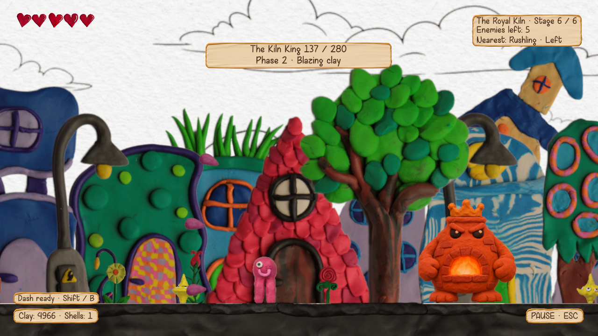
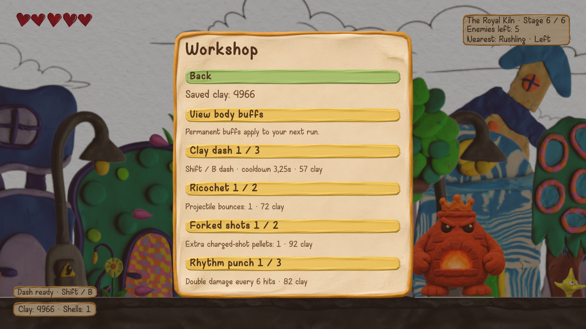
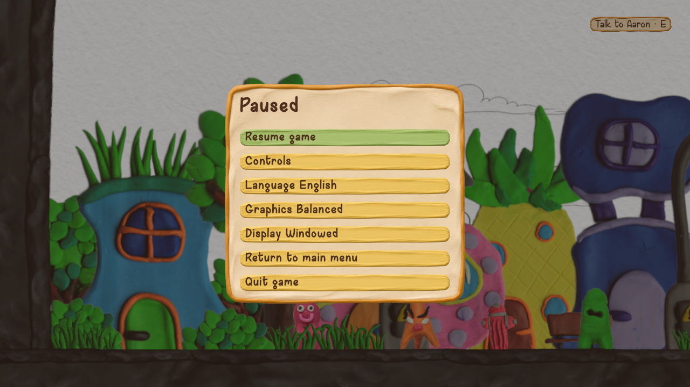
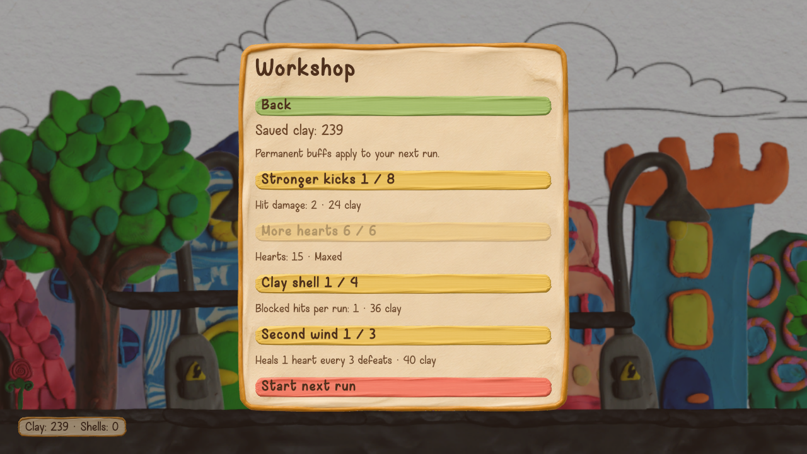

<div align="center">

# Rage · Clay Demo

**A little clay world. Some very unhelpful neighbors. A lot of rage.**

[](LICENSE)
[](docs/BUILDING.md)
[](Refinement)
[](Refinement/Locale.cs)


[**Download & play on Windows**](https://github.com/Natex-corporation/gamejam3-rage/releases/latest/download/Rage-Clay-Demo-Windows-x64.zip) · [Player guide](PLAYING.md) · [Build it](docs/BUILDING.md) · [Explore the source](docs/ARCHITECTURE.md) · [Contribute](CONTRIBUTING.md) · [Changes](CHANGELOG.md)

</div>

Meet Hnoop, the new neighbor in a handmade clay village. Try a conversation. Lose your patience. Then fight, earn clay, reshape yourself in the workshop, and come back stronger across six districts and face the two-phase Kiln King.

This repository opens up the **C# refinement layer** for an existing Windows Unity game: its incremental progression, menus, translations, keyboard remapping, generated stages, checkpoints, and assembly patcher. The standalone release includes the compatible Windows player: **extract the entire ZIP and double-click Rage Demo.exe**. No separate game, Unity Editor, or developer tools are needed to play. The original Unity Editor project is unavailable; this source checkout rebuilds the expansion against the released player.

| Meet the Kiln King | Learn a new trick |
| :---: | :---: |
|  |  |

## Made to feel at home

The added interface uses textured plasticine panels and buttons: hand-pressed edges, soft clay shading, warm cream and ochre slabs, coral actions, and leafy green hover and focus states. Pause, settings, HUD badges, language selection, and captions share the same material and the original StrawberryMuffins lettering.

| Pause without losing your place | Make it yours |
| :---: | :---: |
|  |  |

## What's inside

- **Pause and options:** resume, retry, return to title, graphics presets, and window mode.
- **Four languages:** Czech, English, Slovak, and German, including dialogue and control hints.
- **Flexible controls:** rebind movement, jump, attack, and interaction; retain arrow keys, mouse attack, and controller support.
- **Incremental runs:** saved clay, eight permanent upgrade paths, defeat results, and workshop purchases for the next attempt.
- **Six districts:** an authored climb followed by five generated routes, permanent district unlocks, healing rest points, enemy-clear exits, and a victory screen.
- **New opponents:** arcing lobbers, directional shieldguards, healing menders, splitters and rushlings, plus a two-phase Kiln King with telegraphed slams, volleys, and charges.
- **Runtime fixes:** pause-aware combat and dialogue, input cleanup, and enemy spawn capture after placement.
- **Screen-bound projectiles:** shots disappear once their collider fully leaves the gameplay camera; offscreen collisions cannot damage unseen targets.
- **A source-based patcher:** rebuild changes against a verified original assembly without repackaging Unity libraries.

## Play and controls

Download the [latest Windows demo](https://github.com/Natex-corporation/gamejam3-rage/releases/latest), extract all files, and launch **Rage Demo.exe**. The first game includes the village story; later runs start directly on the course. Open **Options** or press **Esc** for the workshop, language, controls, and graphics.

| Action | Keyboard / mouse | Controller |
| --- | --- | --- |
| Move | A / D or arrow keys | Left stick |
| Jump | Space; hold for more height | A |
| Kick | Tap Enter or left mouse | Tap X |
| Charge and shoot | Hold attack, then release | Hold X, then release |
| Talk / continue | E | Y |
| Dash (purchase required) | Shift | B |
| Pause / resume | Esc | Start |

Keyboard assignments can be changed in **Options → Controls**. Language, key assignments, graphics, and display settings persist locally. Earned clay and purchased buffs are saved immediately and survive defeat and quitting. Cleared districts stay unlocked. Position and unused shell charges belong to the current run.

## Earn, reshape, repeat

Fresh players start with **three hearts** against enemies with **10 / 18 / 26 / 36 / 48 / 60 health** across the six districts; the boss has 280. Every point of enemy health removed earns one clay; defeats and cleared stages award extra. Defeat keeps your wallet and opens the workshop. All enemies must be defeated before a stage exit opens.

| Permanent buff | Effect | Ranks |
| --- | --- | --- |
| Stronger kicks | +1 damage per hit per rank, including projectiles | 8 |
| More hearts | +2 maximum hearts per rank | 6 |
| Clay shell | Block one incoming hit per rank per run | 4 |
| Second wind | Heal one heart every 3 / 2 / 1 defeated enemies | 3 |
| Clay dash | Brief invulnerable burst; ranks shorten cooldown | 3 |
| Ricochet | Shots bounce off terrain once / twice | 2 |
| Forked shots | Wider, multi-pellet charged shots | 2 |
| Rhythm punch | Double damage every 6 / 5 / 4 hits | 3 |

Purchases take effect on the **next run**, and prices rise with each rank. You can inspect or buy buffs from the pause menu, too. See [the progression guide](docs/PROGRESSION.md) for the economy and save behavior.



## Build from source

Use the standalone demo for game references and the release’s **Rage-Developer-Kit.zip** for the untouched original assembly and Mono.Cecil 0.11.6. See the build guide for exact paths and verification. The script uses the .NET Framework C# compiler and Unity references from your installation.

```powershell
git clone https://github.com/Natex-corporation/gamejam3-rage.git
cd gamejam3-rage

.\scripts\build.ps1 `
  -GameData 'C:\Games\Rage\GameJam3_Rage_Data' `
  -OriginalAssembly 'C:\Games\Rage\Original\Assembly-CSharp.dll' `
  -CecilPath 'C:\Tools\Mono.Cecil\lib\net40\Mono.Cecil.dll'
```

This builds into `build/`. Add `-Apply` to install into the supplied game folder after closing the game; previous installed files are backed up first. See [the build guide](docs/BUILDING.md) for compatibility, installation, and rollback.

## Find your way around

```text
Refinement/                 Runtime C# and the assembly patcher
  GameMenu.cs               Pause, workshop, results, shared clay styling
  Locale.cs                 UI language selection and translations
  DialogueTranslations.cs   Dialogue localization and live refresh
  KeyboardBindings.cs       Persistent keyboard overrides
  Course.cs                 Six districts, checkpoints, player tuning
  DemoContent.cs            Enemy variants and two-phase Kiln King
  PlayerTricks.cs           Dash, ricochet, forked shots, rhythm damage
  TitleCaptions.cs          Localized title-button captions
  PatchAssembly.cs          Mono.Cecil integration hooks
  ClayUI.cs                 Textured, nine-sliced clay surfaces
  ProjectileBounds.cs       Viewport cleanup and collision bounds
  Progression.cs            Persistent clay, purchases, rewards, run lifecycle
assets/                     Project-owned clay UI and boss sprites
scripts/                    Build script and optional visual smoke runner
docs/                       Build guide, architecture, screenshots
.github/                    Repository checks and issue templates
```

## For discovery and agents

Start with [AGENTS.md](AGENTS.md), [llms.txt](llms.txt), and [demo-manifest.json](demo-manifest.json). The manifest records the platform, launcher, download and checksum URLs, license scope, and verification argument. [CodeMeta](codemeta.json) provides repository metadata. Release assets include SHA-256 checksums and a manifest tied to the source commit.

This is a compact demo, not a full-length release. An input-driven automated fresh playthrough took six minutes and three defeats; human playtime has not yet been measured.

## Contributing

Bug reports, translation corrections, gameplay improvements, and UI polish are welcome. Read [CONTRIBUTING.md](CONTRIBUTING.md) for a short development workflow and a practical playtest checklist. Keep the handmade aesthetic and test longer German labels as well as English.

## License and project scope

The custom source code, documentation, and newly generated clay UI and boss artwork are available under the **[MIT License](LICENSE)**. Screenshots show the existing game for context. The license does not relicense the original game's artwork, audio, fonts, Unity runtime, or other third-party dependencies; see [third-party notices](THIRD_PARTY_NOTICES.md). The atlas generation prompt and integration notes are in [the artwork guide](docs/ARTWORK.md).

This is a build-compatible refinement project, not a complete Unity Editor checkout. A full game rebuild requires the original `Assets/`, `Packages/`, and `ProjectSettings/`, which are absent from the supplied Windows player folder.
