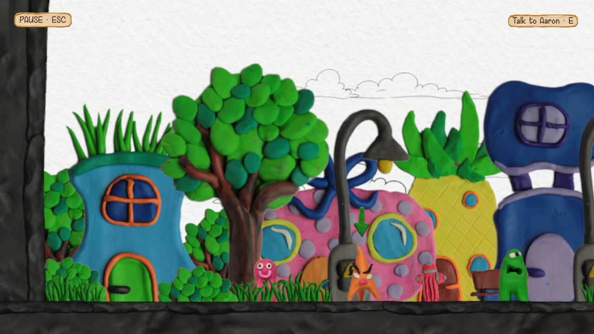
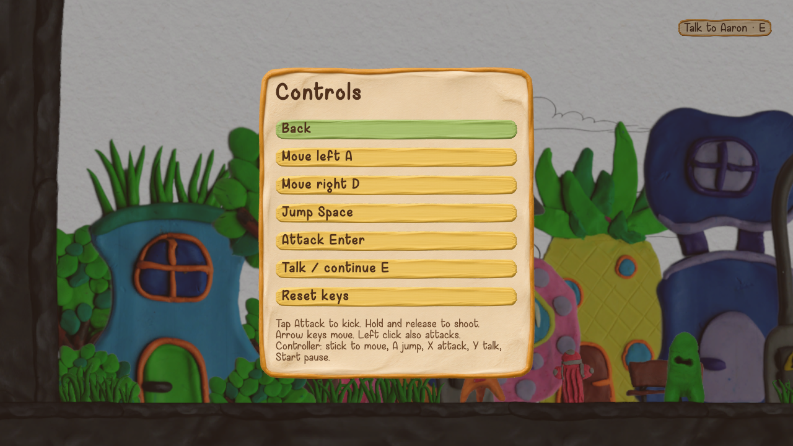

<div align="center">

# GameJam3 · Rage

**A little clay world. Some very unhelpful neighbors. A lot of rage.**

[](LICENSE)
[](docs/BUILDING.md)
[](Refinement)
[](Refinement/Locale.cs)



[Build it](docs/BUILDING.md) · [Explore the source](docs/ARCHITECTURE.md) · [Contribute](CONTRIBUTING.md) · [Changes](CHANGELOG.md)

</div>

Meet Hnoop, the new neighbor in a handmade clay village. Try a conversation. Lose your patience. Then jump, kick, and charge your way through a three-stage platforming course.

This repository opens up the **C# refinement layer** for an existing Windows Unity game: its menus, translations, keyboard remapping, generated stages, checkpoints, and assembly patcher. The original Unity Editor project and game assets are not included. You need a compatible copy of the game to build or play with these changes.

## Made to feel at home

The added interface uses textured plasticine panels and buttons: hand-pressed edges, soft clay shading, warm cream and ochre slabs, coral actions, and leafy green hover and focus states. Pause, settings, HUD badges, language selection, and captions share the same material and the original StrawberryMuffins lettering.

| Pause without losing your place | Make it yours |
| :---: | :---: |
|  |  |

## What's inside

- **Pause and options:** resume, retry, return to title, graphics presets, and window mode.
- **Four languages:** Czech, English, Slovak, and German, including dialogue and control hints.
- **Flexible controls:** rebind movement, jump, attack, and interaction; retain arrow keys, mouse attack, and controller support.
- **A three-stage run:** an adjusted authored climb followed by two generated layouts, with checkpoints and a finish screen.
- **Runtime fixes:** pause-aware combat and dialogue, input cleanup, and enemy spawn capture after placement.
- **Screen-bound projectiles:** shots disappear once their collider fully leaves the gameplay camera; offscreen collisions cannot damage unseen targets.
- **A source-based patcher:** rebuild changes against a verified original assembly without repackaging Unity libraries.

## Play and controls

Launch `GameJam3_Rage.exe` from your existing game installation. Open **Options** or press **Esc** to change language, controls, or graphics. The title menu also offers a shortcut to the generated stages.

| Action | Keyboard / mouse | Controller |
| --- | --- | --- |
| Move | A / D or arrow keys | Left stick |
| Jump | Space; hold for more height | A |
| Kick | Tap Enter or left mouse | Tap X |
| Charge and shoot | Hold attack, then release | Hold X, then release |
| Talk / continue | E | Y |
| Pause / resume | Esc | Start |

Keyboard assignments can be changed in **Options → Controls**. Language, key assignments, graphics, and display settings persist locally. Course progress is held for the current run.

## Build from source

On Windows, bring your compatible game installation, its untouched original `Assembly-CSharp.dll`, and **Mono.Cecil 0.11.6** (`net40/Mono.Cecil.dll`). The script uses the .NET Framework C# compiler and Unity references from your installation.

```powershell
git clone https://github.com/Natex-corporation/gamejam3-rage.git
cd gamejam3-rage

.\scripts\build.ps1 `
  -GameData 'C:\Games\Rage\GameJam3_Rage_Data' `
  -OriginalAssembly 'C:\Games\Rage\Original\Assembly-CSharp.dll' `
  -CecilPath 'C:\Tools\Mono.Cecil\lib\net40\Mono.Cecil.dll'
```

This builds into `build/`. Add `-Apply` to install into the supplied game folder after closing the game; previous installed files are backed up first. See [the build guide](docs/BUILDING.md) for compatibility, installation, and rollback.

## Find your way around

```text
Refinement/                 Runtime C# and the assembly patcher
  GameMenu.cs               Pause, settings, shared paper styling
  Locale.cs                 UI language selection and translations
  DialogueTranslations.cs   Dialogue localization and live refresh
  KeyboardBindings.cs       Persistent keyboard overrides
  Course.cs                 Stages, checkpoints, player tuning
  TitleCaptions.cs          Localized title-button captions
  PatchAssembly.cs          Mono.Cecil integration hooks
  ClayUI.cs                 Textured, nine-sliced clay surfaces
  ProjectileBounds.cs       Viewport cleanup and collision bounds
assets/                     Original clay UI sprite atlas
scripts/                    Build script and optional visual smoke runner
docs/                       Build guide, architecture, screenshots
.github/                    Repository checks and issue templates
```

## Contributing

Bug reports, translation corrections, gameplay improvements, and UI polish are welcome. Read [CONTRIBUTING.md](CONTRIBUTING.md) for a short development workflow and a practical playtest checklist. Keep the handmade aesthetic and test longer German labels as well as English.

## License and project scope

The custom source code, documentation, and newly generated clay UI atlas are available under the **[MIT License](LICENSE)**. Screenshots show the existing game for context. The license does not relicense the original game's artwork, audio, fonts, Unity runtime, or other third-party dependencies; see [third-party notices](THIRD_PARTY_NOTICES.md). The atlas generation prompt and integration notes are in [the artwork guide](docs/ARTWORK.md).

This is a build-compatible refinement project, not a complete Unity Editor checkout. A full game rebuild requires the original `Assets/`, `Packages/`, and `ProjectSettings/`, which are absent from the supplied Windows player folder.
