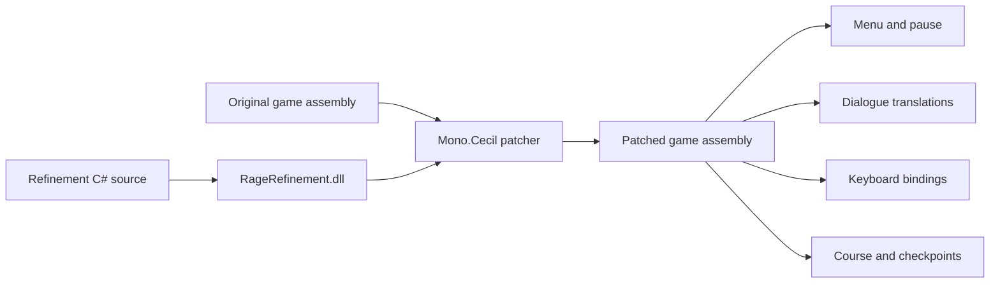

# How the refinement layer fits

`RageRefinement.dll` is loaded by Unity's player manifests. Its `GameMenu.Install` entry point creates one persistent UI Toolkit document after a scene loads. The game remains responsible for characters, art, authored scenes, and base combat.

## Responsibilities

| File | Owns |
| --- | --- |
| `GameMenu.cs` | Persistent UI, paper palette, pause ownership, settings, input blocking, graphics scale |
| `Locale.cs` | Language state, localized UI strings, preference persistence, language change events |
| `DialogueTranslations.cs` | Source-text lookup, translated choices, current-line replay, continue captions |
| `KeyboardBindings.cs` | InputAction asset registration, binding overrides, duplicate-key rejection, defaults |
| `Course.cs` | Three-stage progression, generated placement, checkpoints, health and jump tuning |
| `TitleCaptions.cs` | Localized captions over the game's title controls |
| `PatchAssembly.cs` | Explicit IL hooks into the original game types and input lifecycle |
| `ClayUI.cs` | Runtime atlas loading, nine-slice clay surfaces, hover/focus/press states |
| `ProjectileBounds.cs` | Gameplay camera bounds for projectile cleanup and collision rejection |
| `Progression.cs` | Persistent clay and buffs, per-run snapshots, rewards, defeat/victory lifecycle, enemy tracking |

## Pause contract

Opening an in-game menu captures the previous time scale and audio pause state. Closing restores those values. Patched gameplay input is blocked while paused and briefly after dismissal; dialogue uses a pause-aware delta time. Combat hit-stop writes through the menu helper so it cannot accidentally unpause an open menu.

## Translation contract

Dialogue translations are keyed by the original trimmed line. Unknown text falls back to its source. Language changes refresh the active line and menu labels. The four language names are Czech, English, Slovak, and German; avoid reordering their indices because preferences store an integer.

## Visual direction

Use the existing clay village as visual authority. Added surfaces use the actual textured atlas in `assets/clay-ui.png`, with cream and ochre plasticine, coral actions, and leafy green interaction states. Brown ink `#4F301D` and the original handwritten font keep text readable. Nine-slicing preserves the hand-pressed corners at different menu sizes. The older solid-color styling is a fallback if artwork cannot load. Keep focus visible and check compact layouts with the longest translations.

## Projectile boundary contract

Both `Projectile.FixedUpdate` and `Projectile.OnTriggerEnter2D` are patched to test the collider bounds against the gameplay camera. Once the whole shot leaves any viewport edge, the original `Despawn` method marks it spent and schedules destruction. The collision hook prevents an offscreen hit during the same physics step that crosses the screen edge. Partially visible shots and onscreen damage retain their normal behavior. The original lifetime still handles shots if no gameplay camera is available.

## Patching boundaries

Health initialization applies the saved run's health budget. Health damage passes through progression scaling and a pause guard; health start subscribes reward tracking after scene setup. The player's original death reload is redirected to the result screen. The title's original clay play button starts a new run and selects story or course according to saved story completion. See [PROGRESSION.md](PROGRESSION.md) for prices, rewards, and save boundaries.

The patcher is intentionally tied to the supported game assembly. It expects named types, fields, and call counts, and fails when those contracts no longer hold. Always patch the original DLL and write to a separate output directory. Preserve and review those checks when porting to a different build.
