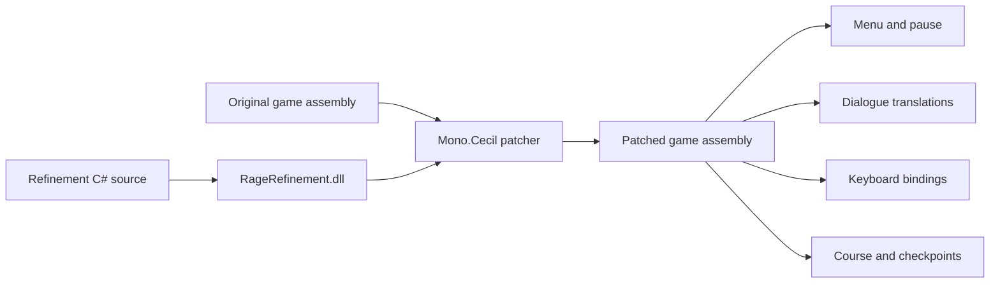

# How the refinement layer fits

`RageRefinement.dll` is loaded by Unity's player manifests. Its `GameMenu.Install` entry point creates one persistent UI Toolkit document after a scene loads. The game remains responsible for characters, art, authored scenes, and base combat.

## Responsibilities

| File | Owns |
| --- | --- |
| `GameMenu.cs` | Persistent UI, paper palette, pause ownership, settings, input blocking, graphics scale |
| `Locale.cs` | Language state, localized UI strings, preference persistence, language change events |
| `DialogueTranslations.cs` | Source-text lookup, translated choices, current-line replay, continue captions |
| `KeyboardBindings.cs` | InputAction asset registration, binding overrides, duplicate-key rejection, defaults |
| `Course.cs` | Three-stage progression, generated placement, checkpoints, health and jump tuning |
| `TitleCaptions.cs` | Localized captions over the game's title controls |
| `PatchAssembly.cs` | Explicit IL hooks into the original game types and input lifecycle |

## Pause contract

Opening an in-game menu captures the previous time scale and audio pause state. Closing restores those values. Patched gameplay input is blocked while paused and briefly after dismissal; dialogue uses a pause-aware delta time. Combat hit-stop writes through the menu helper so it cannot accidentally unpause an open menu.

## Translation contract

Dialogue translations are keyed by the original trimmed line. Unknown text falls back to its source. Language changes refresh the active line and menu labels. The four language names are Czech, English, Slovak, and German; avoid reordering their indices because preferences store an integer.

## Visual direction

Use the existing clay village and dialogue panels as visual authority. Shared menu colors are cream paper `#FCEABE`, brown ink `#4F301D`, orange edging `#E8A64D`, and clay red `#EF6C56`. Reuse the original handwritten font and rounded paper shapes. Keep focus visible and check compact layouts with the longest translations.

## Patching boundaries

The patcher is intentionally tied to the supported game assembly. It expects named types, fields, and call counts, and fails when those contracts no longer hold. Always patch the original DLL and write to a separate output directory. Preserve and review those checks when porting to a different build.
