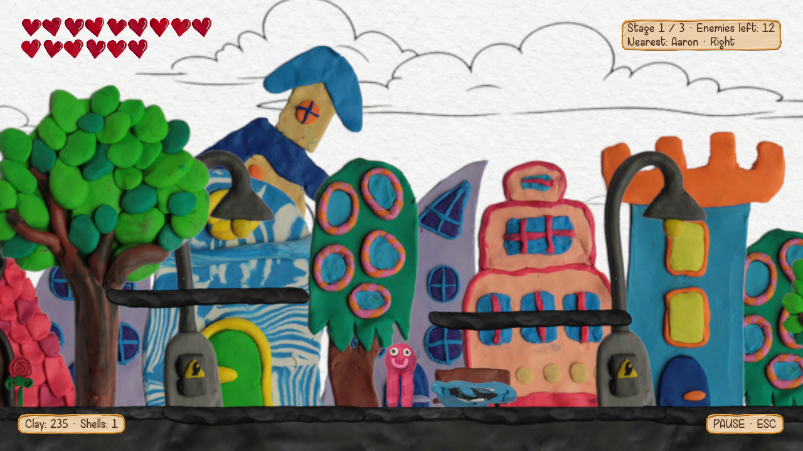

# Incremental runs

The game loop is **fight → earn clay → defeat or victory → workshop → stronger next run**. The village story plays on the first journey and is marked seen when it naturally reaches the course. Later runs start on stage one without repeating the conversations.

## Starting strength and rewards

- Player health starts at 3; maximum upgraded health is 15.
- Enemy health is 8, 14, and 20 on stages one, two, and three.
- Every actual enemy health point removed earns 1 clay. Overkill earns no extra, and healing cannot reset an enemy's reward budget.
- An enemy defeat awards another 8, 12, or 16 clay by stage, once per enemy.
- Clearing a stage awards 25, 50, or 75 clay.
- A failed run awards 4 consolation clay after combat, or after at least five seconds of play. Merely opening and restarting a run awards nothing.

Clay is saved as it is earned. A failed attempt can contribute toward the next purchase even if the player did not defeat an enemy.

## Workshop

| Buff | Base price | Rank cap | Each rank adds |
| --- | --- | --- | --- |
| Stronger kicks | 12 | 8 | +1 damage on hits against enemies |
| More hearts | 16 | 6 | +2 maximum health |
| Clay shell | 24 | 4 | One blocked hit per run |
| Second wind | 28 | 3 | Heal one heart every 3 / 2 / 1 defeats |

At current rank `r`, the next price is `base + 8*r + 4*r*r`. A purchase is rejected if it is unaffordable, outside the four buff slots, or already capped. Each run snapshots the bought ranks at its start, so buying during a pause cannot refill health or shells mid-fight.

## Completing a run

The exit checks all active living enemies in that stage. Defeating only a few enemies and running past the rest no longer finishes the game. Each stage has its own clear reward, and the final clear opens victory results. Defeat and falling out of the level open results instead of immediately reloading. Both results lead to the workshop or a new run.

The upper shelf is a healing rest point, once per stage. It does not preserve stage position after a failed run. The HUD points toward the nearest remaining enemy, and enemies knocked below the world are retired so an unreachable enemy cannot keep an exit locked.

## Save behavior

Progression is stored in one versioned JSON value under Unity PlayerPrefs key `RageRefinement.Progression.v1`, with the last valid value kept as a backup. It contains clay, four upgrade ranks, attempt and victory counts, and whether the village story has been seen. Rank and wallet bounds are checked on load. Ordinary options and keyboard bindings use their existing separate preference keys.

Integration runs pass `-rage-qa-profile <name>` to use a different save key. The smoke suite deliberately resets only its named QA profile; it never resets the player's normal progression.
